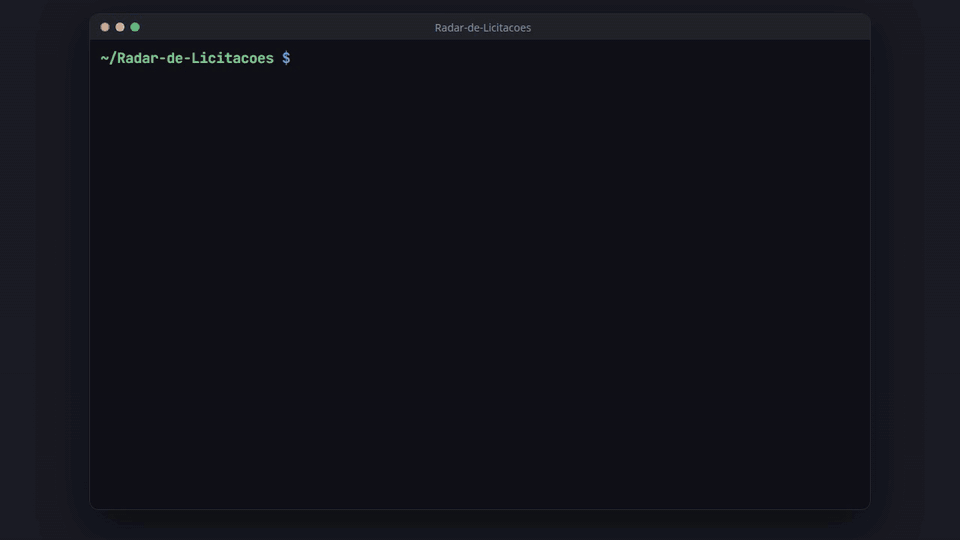

# Radar de Licitações

[](https://henriquelopes741.github.io/Radar-de-Licitacoes/)
[](LICENSE)


**Pare de garimpar licitações.** Todo dia, este pipeline busca as contratações publicadas no Portal Nacional de Contratações Públicas (PNCP) e manda para cada pessoa **só as que importam para ela**: com as palavras-chave, os estados e o valor mínimo que ela escolher. O resto fica num dashboard para explorar, e tudo sobe com um comando.

**[Documentação](https://henriquelopes741.github.io/Radar-de-Licitacoes/)** · [Instalação](https://henriquelopes741.github.io/Radar-de-Licitacoes/instalacao/subir-o-ambiente/) · [Alertas por e-mail](https://henriquelopes741.github.io/Radar-de-Licitacoes/funcoes/alertas/) · [Dashboard](https://henriquelopes741.github.io/Radar-de-Licitacoes/funcoes/dashboard/) · [Carregar o histórico](https://henriquelopes741.github.io/Radar-de-Licitacoes/instalacao/carregar-dias-anteriores/)



<table>
  <tr>
    <td width="60%"></td>
    <td width="40%"></td>
  </tr>
</table>

## Como usar

Com Docker e `make`:

```bash
git clone https://github.com/HenriqueLopes741/Radar-de-Licitacoes.git
cd Radar-de-Licitacoes
make run                # configura, sobe tudo e ativa a coleta diária
make backfill DIAS=30   # opcional: carrega os últimos 30 dias
```

Airflow em http://localhost:8080 (`airflow`/`airflow`) e dashboard em http://localhost:8501.

O passo a passo, a configuração dos alertas e como tudo funciona estão na **[documentação completa →](https://henriquelopes741.github.io/Radar-de-Licitacoes/)**

## Licença

[MIT](LICENSE). Dados públicos da [API do PNCP](https://pncp.gov.br/api/consulta/swagger-ui/index.html).
