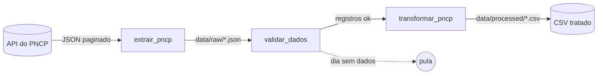

# Pipeline de Compras Públicas com Airflow

Pipeline de dados que coleta diariamente as contratações publicadas no **PNCP** (Portal Nacional de Contratações Públicas), valida o retorno e gera um CSV tratado, pronto para análise. A orquestração é feita com **Apache Airflow** rodando em **Docker**.



## Tecnologias

- **Python 3.12**: `requests` (extração) e `pandas` (transformação)
- **Apache Airflow 3**: agendamento e orquestração
- **Docker Compose**: Airflow com CeleryExecutor, PostgreSQL e Redis
- **pytest**: testes unitários com a API simulada (mock)

## Estrutura do projeto

```
├── dags/
│   └── pncp_pipeline.py     # DAG do Airflow (extrair → validar → transformar)
├── src/
│   ├── extract.py           # coleta na API do PNCP
│   └── transform.py         # limpeza e geração do CSV
├── tests/                   # testes da extração e da transformação
├── data/                    # saída do pipeline (não versionada)
│   ├── raw/                 # JSON bruto, um arquivo por dia
│   └── processed/           # CSV tratado, um arquivo por dia
├── docker-compose.yaml      # ambiente do Airflow
└── requirements.txt         # dependências para rodar localmente
```

## Como funciona

A DAG `pncp_pipeline` roda **todo dia à meia-noite (horário de Brasília)** e processa as contratações publicadas no **dia anterior**. Ela tem três tarefas:

### 1. Extração (`extrair_pncp`)

Consulta o endpoint [`/v1/contratacoes/publicacao`](https://pncp.gov.br/api/consulta/swagger-ui/index.html) da API de consulta do PNCP, filtrando pela data de publicação e pela modalidade **6 (Pregão Eletrônico)**.

- **Paginação:** percorre todas as páginas (50 registros cada) e junta tudo em um único JSON.
- **Limite de requisições:** a API aceita cerca de 8 requisições a cada 45 segundos. Por isso há uma pausa de 6 s entre páginas e, quando a API responde `429`, o pipeline espera o tempo indicado no cabeçalho `Retry-After` (ou 30 s) e tenta de novo, até 5 vezes.
- **Dias sem publicação:** a API responde `204` e a extração salva uma lista vazia.

Saída: `data/raw/contratacoes_AAAAMMDD.json`

### 2. Validação (`validar_dados`)

Confere se o arquivo existe e se contém uma lista de registros. Em dias sem contratações (fins de semana e feriados), a tarefa e a transformação ficam como **puladas** (*skipped*) em vez de falhar.

### 3. Transformação (`transformar_pncp`)

- Achata o JSON aninhado (`orgaoEntidade.razaoSocial` → `orgao`, por exemplo)
- Seleciona e renomeia os campos de interesse
- Remove espaços extras e quebras de linha dos textos
- Converte as datas, anulando valores inválidos
- Remove registros sem identificador e contratações duplicadas

Saída: `data/processed/contratacoes_AAAAMMDD.csv` (UTF-8 com BOM, abre corretamente no Excel)

### Dados gerados

| Coluna | Descrição |
|---|---|
| `numero_controle_pncp` | Identificador único da contratação no PNCP |
| `orgao` | Órgão ou entidade responsável |
| `uf` | Sigla do estado |
| `municipio` | Município da unidade compradora |
| `objeto` | Descrição do que está sendo contratado |
| `modalidade` | Modalidade da contratação |
| `data_publicacao` | Data e hora da publicação no PNCP |
| `data_encerramento` | Prazo final para envio de propostas |
| `valor_estimado` | Valor total estimado (R$) |
| `valor_homologado` | Valor total homologado (R$), quando houver |
| `situacao` | Situação atual da compra |
| `ano_compra` | Ano da compra |
| `link_pncp` | Link para a página da contratação no portal do PNCP |

## Como usar

### Pré-requisitos

- Docker e Docker Compose v2
- Pelo menos 4 GB de RAM disponíveis para o Docker

### Subindo o Airflow

```bash
git clone https://github.com/HenriqueLopes741/pipeline-compras-publicas-airflow.git
cd pipeline-compras-publicas-airflow

# Pastas usadas pelo Airflow e variáveis de ambiente
mkdir -p logs plugins config data
echo "AIRFLOW_UID=$(id -u)" > .env
echo "FERNET_KEY=$(python3 -c 'import base64,os;print(base64.urlsafe_b64encode(os.urandom(32)).decode())')" >> .env

# Inicializa o banco e cria o usuário (apenas na primeira vez)
docker compose up airflow-init

# Sobe os serviços
docker compose up -d
```

Acesse **http://localhost:8080** com usuário `airflow` e senha `airflow`.

### Executando a DAG

1. Na lista de DAGs, ative a `pncp_pipeline` (ela começa pausada).
2. A partir daí, ela roda sozinha todo dia à meia-noite.
3. Para executar na hora, clique em **Acionar**. A execução manual processa o dia anterior. Para escolher outro dia, altere a **Data Lógica**: a DAG processa sempre o dia anterior a ela. Datas anteriores ao `start_date` da DAG (13/10/2026) não executam nenhuma tarefa.

Os arquivos gerados aparecem na pasta `data/` do projeto, que é compartilhada com os containers.

Para parar o ambiente:

```bash
docker compose down        # para os serviços
docker compose down -v     # para e apaga o banco do Airflow
```

### Rodando sem o Airflow

Os scripts também funcionam sozinhos, usando o período fixo definido em `PARAMS` no `src/extract.py`:

```bash
python3 -m venv .venv
source .venv/bin/activate
pip install -r requirements.txt

python -m src.extract      # gera data/raw/contratacoes_<período>.json
python -m src.transform    # gera data/processed/contratacoes.csv
```

### Testes

```bash
pytest
```

Os testes simulam a API e não fazem requisições reais. Eles cobrem a paginação, as novas tentativas após `429`, o tratamento do `204`, a limpeza dos textos, a conversão das datas e a remoção de duplicatas.

## Configuração

| O que mudar | Onde |
|---|---|
| Modalidade da contratação | `PARAMS["codigoModalidadeContratacao"]` em `src/extract.py` |
| Período usado ao rodar sem o Airflow | `PARAMS["dataInicial"]` e `PARAMS["dataFinal"]` em `src/extract.py` |
| Horário de execução | `schedule` em `dags/pncp_pipeline.py` |
| Campos do CSV | dicionário `colunas` em `src/transform.py` |
