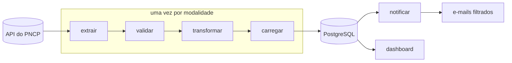

# Pipeline de Compras Públicas com Airflow

[](https://henriquelopes741.github.io/pipeline-compras-publicas-airflow/)
[](LICENSE)


Todo dia, o governo publica cerca de 1.600 pregões eletrônicos no **PNCP** (Portal Nacional de Contratações Públicas). Este projeto coleta essas contratações automaticamente, grava num banco PostgreSQL, mostra tudo num dashboard e manda por e-mail **só o que interessa a cada pessoa**.


## O que ele faz

- **Coleta diária:** à meia-noite, uma DAG do Apache Airflow baixa as contratações do dia anterior pela API pública do PNCP, respeitando o limite de requisições.
- **Banco de dados:** as contratações vão para o PostgreSQL sem duplicatas. Processar um dia de novo só atualiza a situação e os valores.
- **Dashboard:** filtros por UF, município, órgão, palavra-chave, valor e prazo, e o link para o edital de cada contratação.
- **Alertas por e-mail:** cada destinatário escolhe palavras-chave, UFs e valor mínimo e recebe só o que bate com isso, com o CSV em anexo.
- **Histórico:** um comando carrega os dias anteriores com o backfill do Airflow.


## Como funciona



## Começar em um minuto

Com Docker e `make` instalados:

```bash
git clone https://github.com/HenriqueLopes741/pipeline-compras-publicas-airflow.git
cd pipeline-compras-publicas-airflow
make run                # configura, sobe tudo e ativa a DAG
make backfill DIAS=30   # opcional: carrega os últimos 30 dias
```

| Serviço | Endereço |
|---|---|
| Airflow | http://localhost:8080 (usuário `airflow`, senha `airflow`) |
| Dashboard | http://localhost:8501 |
| E-mails de teste (Mailpit) | http://localhost:8025 |

Rode `make` para ver todos os comandos.

## Documentação

O passo a passo completo está no **[site da documentação](https://henriquelopes741.github.io/pipeline-compras-publicas-airflow/)**:

- [Instalação](https://henriquelopes741.github.io/pipeline-compras-publicas-airflow/instalacao/subir-o-ambiente/): pré-requisitos, primeira execução e backfill
- [Como funciona](https://henriquelopes741.github.io/pipeline-compras-publicas-airflow/como-funciona/fluxo/): as tarefas, o agendamento, a API do PNCP e o banco
- [Funções](https://henriquelopes741.github.io/pipeline-compras-publicas-airflow/funcoes/parametros/): parâmetros, dados gerados, dashboard e alertas

## Tecnologias

Python 3.12 · Apache Airflow 3 · PostgreSQL 16 · pandas · Streamlit · Docker Compose · pytest · MkDocs

## Licença

[MIT](LICENSE). Os dados são públicos e vêm da [API de consulta do PNCP](https://pncp.gov.br/api/consulta/swagger-ui/index.html).
