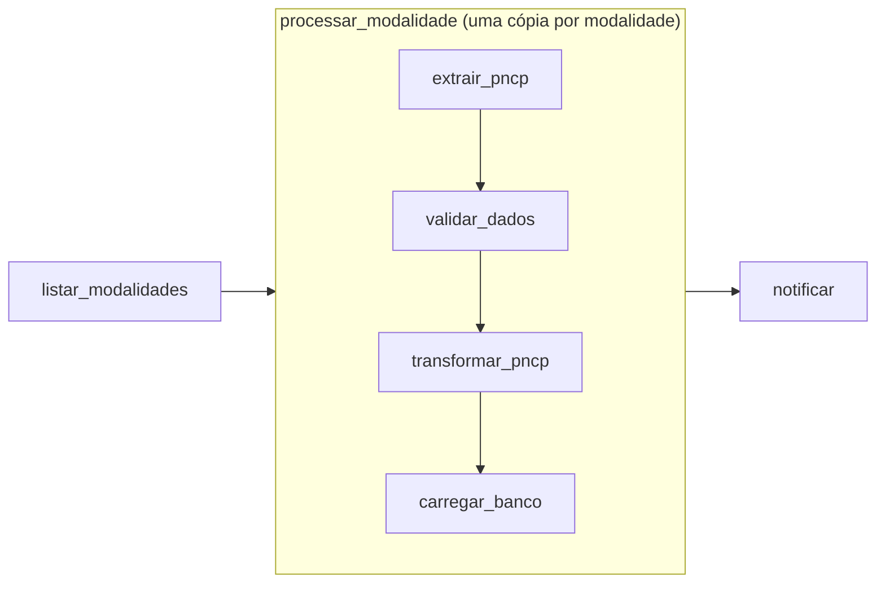

# Fluxo da DAG

A DAG `pncp_pipeline` fica em `dags/pncp_pipeline.py`. O código de cada etapa fica em `src/`, e a DAG só chama essas funções na ordem certa.



## As tarefas

| Tarefa | O que faz | Código |
|---|---|---|
| `listar_modalidades` | Lê os códigos de modalidade informados ao acionar a DAG (padrão: `[6]`) | `dags/pncp_pipeline.py` |
| `extrair_pncp` | Baixa todas as páginas da API do PNCP para o dia e a modalidade e grava o JSON bruto | `src/extract.py` |
| `validar_dados` | Confere se o JSON existe e é uma lista. Se a lista estiver vazia, pula o resto | `dags/pncp_pipeline.py` |
| `transformar_pncp` | Achata o JSON, renomeia e limpa os campos, remove duplicatas, cria o link do edital e grava o CSV | `src/transform.py` |
| `carregar_banco` | Grava o CSV na tabela `contratacoes` do banco `pncp`, atualizando o que já existia | `src/load.py` |
| `notificar` | Filtra as contratações do dia para cada destinatário e envia os e-mails | `src/alertas.py` |

## Uma cópia por modalidade

As quatro tarefas do meio formam o grupo `processar_modalidade`. A DAG cria **uma cópia do grupo para cada modalidade** pedida (o *dynamic task mapping* do Airflow). Com `[6, 8, 9]`, por exemplo, a grade mostra três cópias, numeradas `[0]`, `[1]` e `[2]`, e cada uma tem os seus arquivos.

Assim, uma modalidade sem contratações no dia, ou que falhou, não atrapalha as outras.

A tarefa `extrair_pncp` roda **uma de cada vez** na DAG inteira (`max_active_tis_per_dag=1`), mesmo com várias modalidades ou vários dias de backfill ao mesmo tempo. As outras ficam na fila. Isso evita estourar o limite de requisições da API (veja [API do PNCP](api-pncp.md)).

## Dias sem contratações

Em fins de semana e feriados, a API pode não ter nada para a modalidade. A extração grava uma lista vazia, e a `validar_dados` marca a si mesma e as tarefas seguintes do grupo como **puladas** (*skipped*, cor-de-rosa na grade). Pular não é erro: a execução termina com sucesso.

## Quando o envio dos alertas roda

A `notificar` espera todas as cópias do grupo terminarem e roda com a regra `none_failed`:

| Situação das modalidades | `notificar` |
|---|---|
| Todas deram certo | Roda |
| Alguma foi pulada (dia sem contratações) | Roda |
| Alguma falhou | Não roda, para não mandar um alerta com o dia incompleto |

Ela também é pulada quando não existe `config/alertas.yml`. Os detalhes estão em [Alertas por e-mail](../funcoes/alertas.md).

## Novas tentativas

Toda tarefa que falha é tentada de novo **até 3 vezes, com 5 minutos de intervalo**. Isso cobre instabilidades da API do PNCP e o caso da máquina que estava suspensa: a execução atrasada dispara logo ao acordar, às vezes antes de a rede voltar.

Só depois da última tentativa a tarefa fica vermelha (*failed*).

## Arquivos intermediários

As tarefas passam umas para as outras o **caminho** do arquivo, não os dados. O JSON e o CSV ficam em `data/`, que é compartilhada com a máquina:

```
data/
├── raw/          # contratacoes_AAAAMMDD_m<modalidade>.json
└── processed/    # contratacoes_AAAAMMDD_m<modalidade>.csv
```

Processar o mesmo dia de novo sobrescreve os arquivos dele. O formato dos arquivos está em [Dados gerados](../funcoes/dados-gerados.md).
