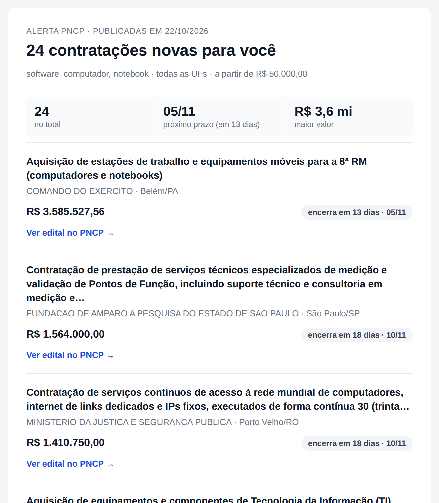

# Alertas por e-mail

Um dia de Pregão Eletrônico tem cerca de 1.600 contratações: mandar tudo por e-mail não ajuda ninguém. Os alertas mandam a cada destinatário **só as contratações que batem com os critérios dele**, com o CSV filtrado em anexo.

O envio é feito pela tarefa `notificar`, no fim da DAG, depois que todas as modalidades foram carregadas no banco.

## Configurar os destinatários

Os destinatários ficam em `config/alertas.yml`. Crie o arquivo a partir do modelo e ajuste:

```bash
make alertas
```

O `make alertas` só copia o `config/alertas.exemplo.yml` se o `alertas.yml` ainda não existir: um arquivo já configurado nunca é sobrescrito.

```yaml
destinatarios:
  # Palavras-chave e valor mínimo, no Brasil todo (cerca de 50 por dia)
  - email: ti@exemplo.com
    palavras_chave: ["software", "computador", "notebook", "informática", "tecnologia da informação", "impressora"]
    valor_minimo: 100000

  # Palavras-chave e estados (cerca de 30 por dia)
  - email: alimentos@exemplo.com
    palavras_chave: ["alimentação escolar", "merenda", "gêneros alimentícios"]
    ufs: ["SP", "MG", "PR", "RS", "SC"]

  # Só palavras-chave, avisando também nos dias sem resultados (cerca de 100 por dia)
  - email: saude@exemplo.com
    palavras_chave: ["medicamento", "material hospitalar", "insumos hospitalares", "material médico"]
    enviar_se_vazio: true
```

As médias são de dias úteis de Pregão Eletrônico em outubro de 2026. Cada destinatário mostra um jeito de combinar os critérios.

O `alertas.yml` fica fora do Git, porque tem e-mails reais. Mudanças nele valem na próxima execução, sem reiniciar nada.

| Campo | Obrigatório | Padrão | O que faz |
|---|---|---|---|
| `email` | sim | | Endereço do destinatário |
| `palavras_chave` | não | todas | Lista de palavras. Basta **uma** aparecer no objeto |
| `ufs` | não | todas | Lista de siglas de estados |
| `valor_minimo` | não | sem mínimo | Valor estimado mínimo, em reais |
| `enviar_se_vazio` | não | `false` | Envia o e-mail mesmo num dia sem resultados |

Os critérios preenchidos **valem juntos**: no exemplo, `alimentos@exemplo.com` recebe as contratações com "alimentação escolar", "merenda" **ou** "gêneros alimentícios" no objeto, **e** de SP, MG, PR, RS ou SC. Um destinatário sem nenhum critério recebe todas as contratações do dia.

> **Comece amplo e afine depois.** Um critério estreito demais, como uma palavra rara num único estado, pode passar semanas sem nenhum resultado. Liste várias palavras do mesmo assunto e use `valor_minimo` para cortar o volume, em vez de restringir muito as palavras.

## Como as palavras-chave são comparadas

- **Sem diferenciar acentos nem maiúsculas.** `computacao` acha "Computação" e `SOFTWARE` acha "software".
- **Pelo começo da palavra.** `software` acha "softwares", mas `ti` não acha "a**ti**vidades". Isso evita que siglas curtas tragam metade do dia.
- **A expressão inteira.** `material de limpeza` só acha esse trecho, com as palavras nessa ordem.

Para pegar variações, liste cada uma: `["medicamento", "remédio", "fármaco"]`.

## Valor mínimo e valor sigiloso

Cerca de 1 em cada 6 contratações tem o valor estimado zerado, em geral porque o orçamento é sigiloso. Com `valor_minimo`, essas contratações **ficam de fora**, porque não dá para saber se passam do mínimo.

Para recebê-las, não use `valor_minimo`.

## O que chega no e-mail



- **Assunto:** a quantidade, o critério principal, o maior valor e o dia, como `PNCP: 24 contratações de software, computador… · maior R$ 3,6 mi · 22/10`. Assim, quem recebe mais de um alerta distingue um do outro na caixa de entrada.
- **Texto de prévia:** a linha que aparece ao lado do assunto, com o próximo prazo e a maior contratação.
- **Resumo:** o total, o próximo prazo de encerramento e o maior valor.
- **Uma contratação por bloco:** o objeto (cortado em 160 caracteres; o texto inteiro está no edital e no CSV), o órgão, o município, o valor e o prazo em dias. O selo do prazo fica **vermelho** quando faltam até 3 dias e **amarelo** até 7. O link "Ver edital no PNCP" abre a página da contratação.
- **Anexo:** `contratacoes-pncp-2026-10-22.csv`, com todas as contratações filtradas e as mesmas colunas do [CSV do pipeline](dados-gerados.md#colunas).

O layout é de uma coluna só, para ler no celular sem rolar para o lado.

O corpo mostra no máximo as **30 de maior valor**. Quando há mais, o e-mail avisa que todas estão no anexo. O limite deixa o e-mail bem abaixo dos 102 KB a partir dos quais o Gmail corta a mensagem. Ele fica em `LIMITE_NO_EMAIL`, em `src/alertas.py`, e o modelo do e-mail em `src/templates/alerta.html`.

Os alertas usam **todas as contratações do dia no banco**, de todas as modalidades já carregadas, e não só as da execução atual.

## Dia sem resultados

| `enviar_se_vazio` | Nenhuma contratação bateu |
|---|---|
| `false` (padrão) | Não envia nada |
| `true` | Envia um e-mail curto, com o assunto `PNCP: nenhuma contratação de medicamento · 22/10` e sem anexo |

O `true` serve para quem quer a confirmação diária de que o alerta está funcionando.

## Quando a tarefa roda, pula ou falha

| Situação | `notificar` |
|---|---|
| Todas as modalidades carregadas, ou puladas por falta de dados | Roda |
| Alguma modalidade falhou | Não roda, para não alertar com o dia incompleto |
| Não existe `config/alertas.yml` | Pulada |
| O `alertas.yml` tem um erro | **Falha** antes de enviar qualquer e-mail |

O arquivo é validado inteiro antes do primeiro envio. A mensagem de erro, no log da tarefa, diz a posição do destinatário na lista (contando do 0) e o campo com problema: `destinatarios.1.ufs` é o campo `ufs` do segundo destinatário. Os erros mais comuns:

| Erro | Exemplo |
|---|---|
| Campo com nome errado | `palavra_chave` em vez de `palavras_chave` |
| UF que não existe | `ufs: ["XX"]` |
| E-mail sem `@` ou sem domínio | `email: pessoa.exemplo.com` |
| Valor mínimo negativo | `valor_minimo: -1` |
| Lista de destinatários vazia | `destinatarios: []` |

Um campo com nome errado é erro, e não é ignorado, de propósito: um `palavra_chave` ignorado em silêncio faria a pessoa receber todas as contratações do dia.

## Testar com o Mailpit

O projeto vem com o **Mailpit**, um servidor de e-mail de teste. Ele recebe as mensagens e **não entrega a ninguém**: elas ficam numa caixa de entrada em **http://localhost:8025**, com o corpo e o anexo.

Para testar:

1. Crie o `config/alertas.yml` com `make alertas` (os endereços do exemplo servem).
2. Acione a DAG para um dia que já está no banco: `make rodar DATA=2026-10-20`.
3. Abra http://localhost:8025 e veja um e-mail por destinatário.

Dois destinatários com critérios diferentes recebem e-mails diferentes, da mesma execução.

## Enviar e-mails de verdade

O servidor de e-mail é a conexão `smtp_default`, definida no `docker-compose.yaml` pela variável `AIRFLOW_CONN_SMTP_DEFAULT`. Por padrão, ela aponta para o Mailpit:

```yaml
AIRFLOW_CONN_SMTP_DEFAULT: '{"conn_type": "smtp", "host": "mailpit", "port": 1025, "extra": {"disable_tls": true, "disable_ssl": true, "from_email": "alertas@pncp.local"}}'
```

Para enviar de verdade, troque pelos dados do seu servidor. Com uma conta do Gmail, por exemplo:

```yaml
AIRFLOW_CONN_SMTP_DEFAULT: '{"conn_type": "smtp", "host": "smtp.gmail.com", "port": 587, "login": "voce@gmail.com", "password": "SENHA_DE_APP", "extra": {"disable_ssl": true, "from_email": "voce@gmail.com"}}'
```

| Campo | O que é |
|---|---|
| `host` e `port` | Endereço do servidor SMTP. Em geral, porta `587` (STARTTLS) ou `465` (SSL) |
| `login` e `password` | Usuário e senha do servidor. No Gmail, use uma [senha de app](https://support.google.com/accounts/answer/185833), e não a senha da conta |
| `disable_ssl` | `true` na porta 587, que começa sem criptografia e passa a usar TLS; `false` na porta 465 |
| `disable_tls` | `true` só para servidores sem criptografia, como o Mailpit |
| `from_email` | O remetente que aparece no e-mail |

Depois de mudar, rode `make run`: ele recria os containers do Airflow, que passam a ler a variável nova.

> **Não faça commit da senha.** O `docker-compose.yaml` é versionado. Desfaça a mudança antes de um commit, ou mantenha a versão com a senha só na sua máquina.

Uma conexão `smtp_default` criada na tela de conexões do Airflow **não tem efeito**: a variável de ambiente tem prioridade sobre ela.
