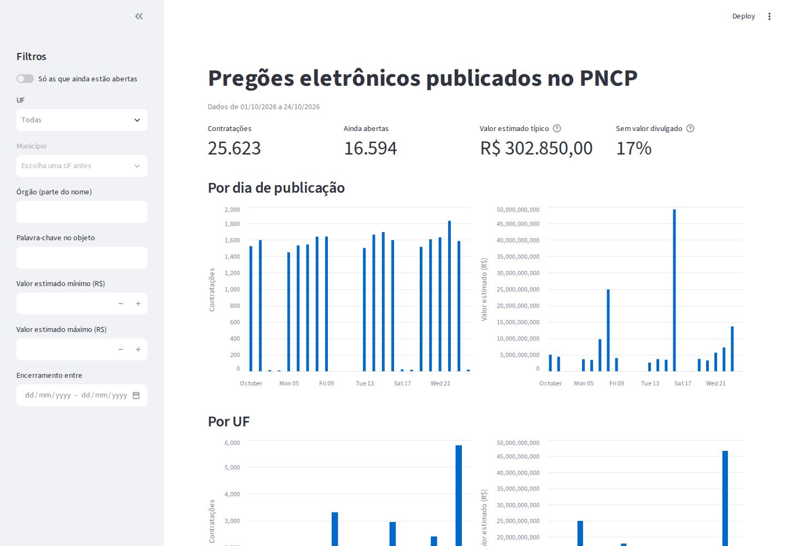

# Dashboard

O dashboard mostra as contratações do banco `pncp` com filtros, indicadores, gráficos e a lista completa com o link de cada edital. Ele sobe junto com o resto do projeto, no serviço `dashboard` do Docker Compose.

**Endereço:** http://localhost:8501



Num ambiente novo, o dashboard avisa que ainda não há dados. Basta esperar a primeira carga da DAG terminar e recarregar a página.

## Filtros

Ficam na barra lateral e valem juntos.

| Filtro | Como funciona |
|---|---|
| **Só as que ainda estão abertas** | Mostra só as contratações com encerramento hoje ou depois, ordenadas pelas que encerram antes |
| **UF** | Um estado |
| **Município** | Libera depois de escolher a UF. Lista só os municípios dela |
| **Órgão** | Parte do nome, sem diferenciar maiúsculas. `saude` acha `SECRETARIA MUNICIPAL DE SAUDE` |
| **Palavra-chave no objeto** | Parte do texto do objeto, sem diferenciar maiúsculas |
| **Valor estimado mínimo e máximo** | Em reais. Os dois limites entram no resultado |
| **Encerramento entre** | Intervalo de datas do prazo das propostas. O último dia entra inteiro |

> **Acentos contam.** No dashboard, `saude` não acha `SAÚDE`. Os alertas por e-mail, por outro lado, ignoram os acentos.

## Indicadores

| Indicador | O que mostra |
|---|---|
| **Contratações** | Quantas passaram pelos filtros |
| **Ainda abertas** | Quantas têm encerramento hoje ou depois |
| **Valor estimado típico** | A **mediana** do valor estimado, sem contar as de valor sigiloso |
| **Sem valor divulgado** | A fração com valor estimado zerado, em geral por orçamento sigiloso |

O dashboard usa a mediana, e não a soma ou a média, porque poucas contratações enormes dominam o total: uma única ata de registro de preços pode passar de R$ 1 bilhão num dia em que a maioria fica abaixo de R$ 100 mil.

## Gráficos e tabela

- **Por dia de publicação** e **Por UF**: quantidade de contratações e valor estimado somado, lado a lado.
- **Contratações**: a lista com encerramento, dias até encerrar, UF, município, órgão, objeto, valor e o link **Abrir** para o edital no PNCP. Sem o filtro de abertas, a ordem é da publicação mais recente para a mais antiga.
- **Baixar CSV**: baixa as contratações filtradas, com todas as colunas.

## Atualização dos dados

O dashboard guarda o resultado de cada consulta por **10 minutos**. Uma carga que acabou de terminar pode levar esse tempo para aparecer. Para ver na hora, use **Clear cache** no menu ⋮ do canto superior direito e recarregue.

## Mudar o dashboard

O código fica em `dashboard/`: `app.py` monta a tela, e `consultas.py` faz as consultas ao banco e os cálculos dos indicadores.

O código vai **dentro da imagem** do container. Depois de mudar algo, monte a imagem de novo:

```bash
docker compose up -d --build dashboard
```

Para ver as mudanças a cada arquivo salvo, rode o dashboard fora do Docker (veja [Rodar sem o Docker e testes](../instalacao/desenvolvimento.md#dashboard)).
