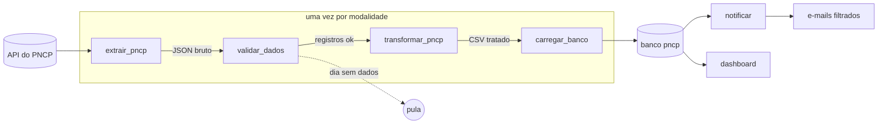

# Pipeline de Compras Públicas com Airflow

Pipeline de dados que coleta, todo dia, as contratações publicadas no **PNCP** (Portal Nacional de Contratações Públicas). Ele trata os dados, grava num banco PostgreSQL, mostra tudo num dashboard e manda por e-mail só o que interessa a cada pessoa. A orquestração é feita com **Apache Airflow 3** rodando em **Docker**.

## O que você ganha

- **Um banco com as contratações do dia**, que se atualiza sozinho à meia-noite e não duplica registros quando um dia é processado de novo.
- **Um CSV por dia e por modalidade**, pronto para abrir no Excel.
- **Um dashboard** com filtros por UF, município, órgão, palavra-chave, valor e prazo, e um link para o edital de cada contratação.
- **Alertas por e-mail**: cada destinatário recebe só as contratações que batem com as suas palavras-chave, UFs e valor mínimo, com o CSV filtrado em anexo.

## Por onde começar

| Quero... | Página |
|---|---|
| Subir o projeto pela primeira vez | [Subir o ambiente](instalacao/subir-o-ambiente.md) |
| Trazer o histórico dos últimos dias | [Carregar dias anteriores](instalacao/carregar-dias-anteriores.md) |
| Entender o que cada tarefa faz | [Fluxo da DAG](como-funciona/fluxo.md) |
| Saber qual dia cada execução processa | [Agendamento](como-funciona/agendamento.md) |
| Coletar outras modalidades ou outro dia | [Parâmetros da DAG](funcoes/parametros.md) |
| Consultar os dados no banco | [Banco de dados](como-funciona/banco.md) |
| Configurar os e-mails | [Alertas por e-mail](funcoes/alertas.md) |

## Tecnologias

- **Python 3.12**: `requests` na extração, `pandas` na transformação, `pydantic` e `Jinja2` nos alertas
- **Apache Airflow 3**: agendamento e orquestração, com CeleryExecutor
- **PostgreSQL 16**: banco do Airflow e banco `pncp` com os dados do pipeline
- **Streamlit**: dashboard
- **Mailpit**: servidor de e-mail de teste, que guarda as mensagens em vez de entregá-las
- **Docker Compose**: sobe tudo com um comando
- **pytest**: testes com a API simulada e um banco de testes real
